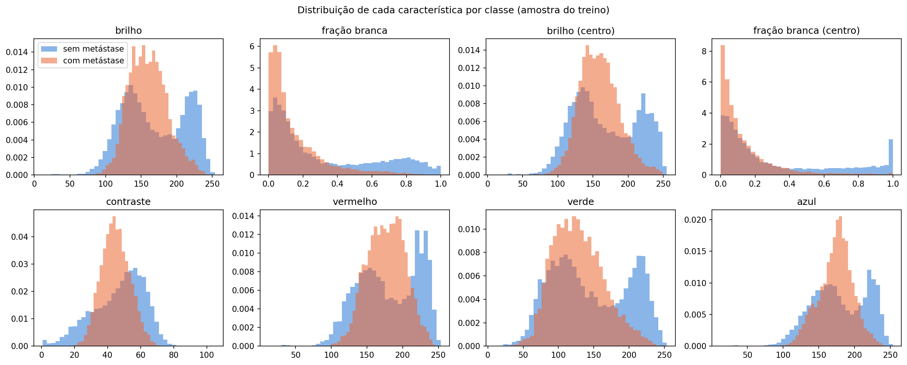
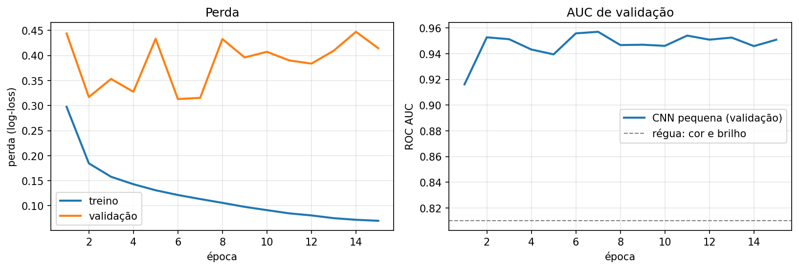
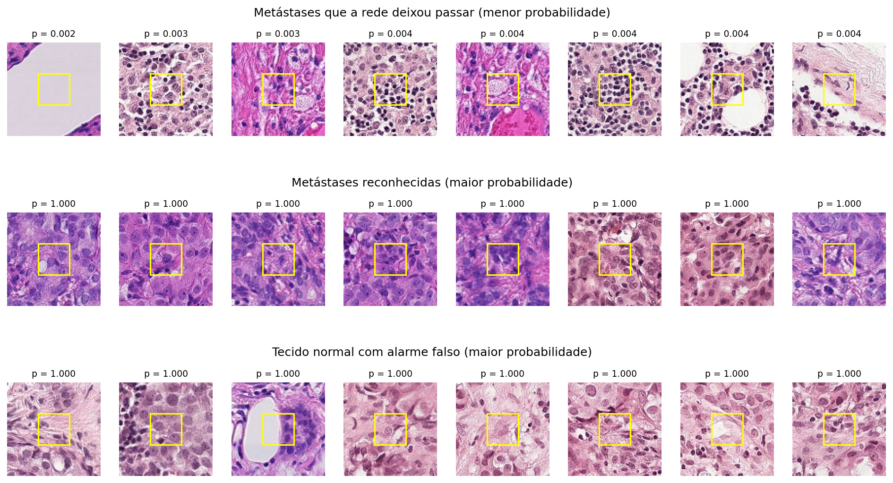
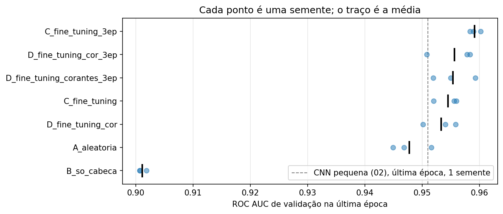
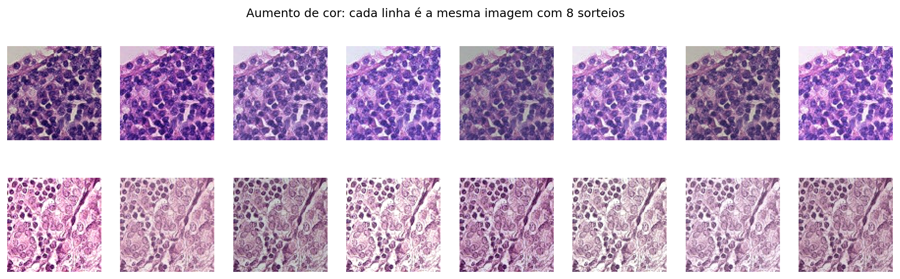
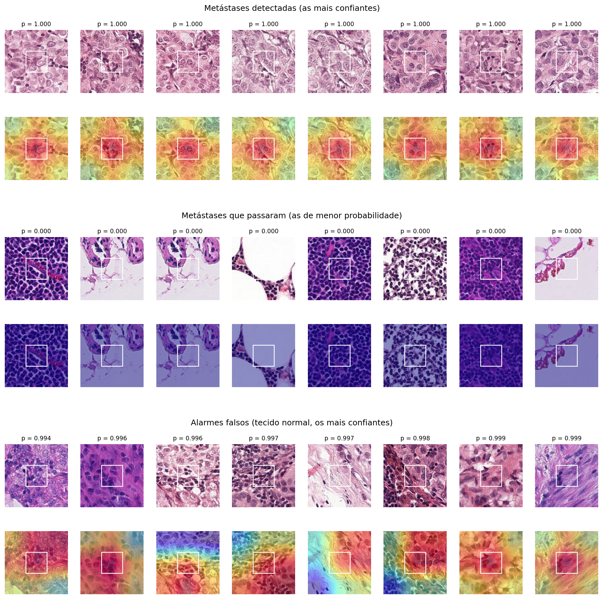

# Detecção de metástase em imagens de histopatologia (PatchCamelyon)

Redes neurais convolucionais para identificar metástase de câncer de mama em patches de linfonodo, com foco em **comparações honestas** (várias sementes, última época, nenhuma escolha feita no teste), **um limiar pensado para triagem** (priorizando sensibilidade) e **interpretabilidade** (Grad-CAM medido em milhares de imagens, não só em exemplos escolhidos).

> **Resultado final (teste, aberto uma única vez):** um ensemble de 3 ResNet-18 pré-treinadas, com previsão nas 8 simetrias de cada imagem, chega a **AUC 0,951**. No limiar escolhido na validação, detecta **91,1% das metástases** com **82,9% de especificidade**. Com o limiar padrão de 0,5, detectaria só 69,0%. Todas as expectativas registradas antes de abrir o teste se confirmaram.

| | AUC | Sensibilidade | Especificidade |
|---|---|---|---|
| **Ensemble + TTA (modelo final) — teste** | **0,951** | **0,911** | **0,829** |
| ResNet-18 única (média de 3 sementes) — teste | 0,939 | — | — |
| CNN pequena treinada do zero (baseline) — teste | 0,932 | — | — |
| Ensemble + TTA — validação | 0,967 | 0,950 | 0,819 |

Sensibilidade e especificidade no limiar escolhido para 95% de sensibilidade na validação.

---

## Sumário

1. [O problema](#1-o-problema)
2. [Os dados](#2-os-dados)
3. [Metodologia](#3-metodologia)
4. [Análise exploratória: o atalho do fundo branco](#4-análise-exploratória-o-atalho-do-fundo-branco)
5. [Baseline: uma CNN pequena do zero](#5-baseline-uma-cnn-pequena-do-zero)
6. [Transfer learning: 7 configurações × 3 sementes](#6-transfer-learning-7-configurações--3-sementes)
7. [Modelo final no teste](#7-modelo-final-no-teste)
8. [Interpretabilidade (Grad-CAM)](#8-interpretabilidade-grad-cam)
9. [Engenharia](#9-engenharia)
10. [Limitações e próximos passos](#10-limitações-e-próximos-passos)
11. [Como reproduzir](#11-como-reproduzir)

---

## 1. O problema

Quando um câncer de mama se espalha, os linfonodos próximos costumam ser os primeiros atingidos. Patologistas examinam lâminas inteiras desses linfonodos ao microscópio em busca de metástases — um trabalho longo, em que focos pequenos passam despercebidos com facilidade.

A tarefa aqui é a versão em patches desse problema: dada uma imagem de 96×96 pixels de uma lâmina corada com hematoxilina e eosina (H&E), dizer se **o quadrado central de 32×32 pixels contém tecido tumoral**. A borda não define o rótulo; serve só de contexto.

Num uso de **triagem**, os dois erros não pesam igual: deixar passar uma metástase é muito pior que um alarme falso, que só custa uma segunda olhada de um patologista. Por isso o limiar de decisão prioriza a sensibilidade.

> Projeto de estudo. Não é um dispositivo médico e não deve ser usado em diagnóstico.

## 2. Os dados

**PatchCamelyon (PCam)** — Veeling et al., *Rotation Equivariant CNNs for Digital Pathology* (MICCAI 2018) — derivada das lâminas do desafio **Camelyon16**. Licença CC0. Usamos o espelho no Hugging Face (`1aurent/PatchCamelyon`, ~7,6 GB em parquet), baixado em 📓 [`notebooks/00_download_dados.ipynb`](notebooks/00_download_dados.ipynb).

| Split | Imagens | Fração com metástase |
|---|---|---|
| Treino | 262.144 | 50% |
| Validação | 32.768 | 50% |
| Teste | 32.768 | 50% |

- **Splits oficiais, sem reembaralhar.** Treino e validação são lâminas **distintas**, vindas do conjunto de treino do Camelyon16 (a validação é um subconjunto de 20% das lâminas); o teste vem do conjunto de teste do desafio, coletado à parte. Misturar os splits colocaria patches da mesma lâmina dos dois lados.
- **Os rótulos vêm de contornos desenhados à mão** nas lâminas inteiras. Isso gera ruído: há patches "positivos" com o quadrado central quase vazio (seção 5).

## 3. Metodologia

### Métricas

| Métrica | Papel | Por quê |
|---|---|---|
| **ROC AUC** | Principal | Mede se as metástases ficam acima do tecido normal na ordem das pontuações, sem depender de limiar. É a métrica do artigo da base. |
| **Sensibilidade e especificidade** | No limiar de operação | O que importa na triagem: quantas metástases são encontradas e quantos alarmes falsos isso custa. |
| **Log-loss** | Calibração | Pune previsões confiantes e erradas; mostra se as probabilidades podem ser lidas ao pé da letra (aqui, não podem). |

### Protocolo

- **Toda decisão é tomada na validação:** arquitetura, número de épocas, aumento de dados, ensemble, TTA e limiar.
- **Comparações com 3 sementes e pela última época.** No baseline, a AUC de validação oscilou ±0,01 entre épocas consecutivas; escolher o pico de uma curva assim dá um número otimista. Com o agendamento cosseno terminando perto de zero, a última época é o modelo final de cada treino, sem nenhuma escolha. Entre sementes, os desvios ficaram entre 0,001 e 0,004.
- **O teste foi aberto uma única vez.** Antes, as decisões foram congeladas num arquivo ([`models/decisoes_pre_teste.json`](models/decisoes_pre_teste.json)) e as expectativas foram escritas com números no notebook (pré-registro). A célula do teste lê as decisões do arquivo, não da memória.

## 4. Análise exploratória: o atalho do fundo branco

📓 [`notebooks/01_eda.ipynb`](notebooks/01_eda.ipynb)

Antes de qualquer rede, uma pergunta: **quanto dá para acertar só com cor e brilho?** Medimos 8 características simples por imagem (brilho, fração de pixels brancos, contraste, médias de R, G e B) e treinamos uma regressão logística com elas.

| Característica | ROC AUC (validação) |
|---|---|
| **Regressão logística com as 8** | **0,810** |
| Fração de pixels brancos | 0,695 |
| Fração de pixels brancos no centro | 0,684 |
| Média do verde | 0,628 |
| Contraste | 0,487 |

Esse **0,810 virou a régua**: uma rede só é interessante se passar bem dele. E ficou uma pergunta para o fim — a rede vai usar o fundo branco como atalho? (Resposta na seção 8: não.)



## 5. Baseline: uma CNN pequena do zero

📓 [`notebooks/02_baseline.ipynb`](notebooks/02_baseline.ipynb)

Uma CNN de 4 blocos convolucionais (1,17 milhão de parâmetros), treinada do zero por 15 épocas, com aumento de dados pelas **8 simetrias do quadrado** (espelhos e rotações de 90°: tecido no microscópio não tem "lado de cima").

- **AUC de validação ~0,95** já na época 2 — muito acima da régua de 0,810.
- **Sobreajuste na calibração, não na ordenação:** a perda de treino cai de 0,30 para 0,07, a de validação sobe de ~0,31 para ~0,40, e a AUC fica estável. A rede ordena bem, mas fica confiante demais nos erros.
- **O erro é deixar passar metástase:** com limiar 0,5, sensibilidade de 0,794 e especificidade de 0,968.



Olhando os erros, apareceram três tipos: patches "positivos" quase vazios (provável efeito dos contornos grosseiros das anotações — erro irredutível), tumor espalhado entre linfócitos, e alarmes falsos em tecido com células grandes, parecido com metástase real.



## 6. Transfer learning: 7 configurações × 3 sementes

📓 [`notebooks/03_transfer_learning.ipynb`](notebooks/03_transfer_learning.ipynb)

Todas com a **ResNet-18**, comparadas pela AUC de validação da última época (média ± desvio de 3 sementes):

| Configuração | Épocas | AUC | Log-loss |
|---|---|---|---|
| **`C_fine_tuning_3ep`** — pré-treinada na ImageNet, rede toda ajustada | 3 | **0,959 ± 0,001** | 0,357 |
| `D_fine_tuning_cor_3ep` — idem + aumento de cor por canais | 3 | 0,956 ± 0,004 | 0,333 |
| `D_fine_tuning_corantes_3ep` — idem + aumento por corantes (H&E) | 3 | 0,955 ± 0,004 | 0,342 |
| `C_fine_tuning` | 10 | 0,955 ± 0,002 | 0,552 |
| `D_fine_tuning_cor` | 10 | 0,953 ± 0,003 | 0,450 |
| `A_aleatoria` — pesos aleatórios (controle) | 10 | 0,948 ± 0,003 | 0,457 |
| `B_so_cabeca` — pré-treinada, só a última camada treinada | 10 | 0,901 ± 0,001 | 0,402 |



- **Só treinar a cabeça é claramente pior (0,901).** As características da ImageNet servem para tecido, mas não bastam.
- **Uma rede maior, sozinha, não ajuda:** a ResNet-18 do zero (0,948) empata com a CNN pequena e oscila muito durante o treino. O controle `A_aleatoria` existe para separar o efeito do pré-treino do efeito do tamanho da rede.
- **O pré-treino ajuda, mas pouco** (+0,007), e o ganho mais claro é velocidade: AUC de 0,955 já na primeira época.
- **Fine-tuning curto é melhor que longo:** com 10 épocas a rede sobreajusta (log-loss 0,55); com 3, a AUC sobe e a calibração melhora. As versões de 3 épocas foram criadas depois de a primeira rodada mostrar sobreajuste a partir da época 3.
- **O aumento de cor não melhorou a AUC**, em nenhuma das duas formas:
  - **por canais** (brilho, contraste, saturação ±20%, ganho por canal ±5%): reduz o excesso de confiança no treino longo, mas não muda a ordenação;
  - **por corantes**: converte RGB em quantidade de hematoxilina e eosina (densidade óptica, lei de Beer-Lambert, matriz de Ruifrok e Johnston) e varia cada corante em ±50%. A variação é forte, mas continua parecendo H&E.
  - Uma versão forte do aumento por canais (±15% por canal) foi **rejeitada antes de treinar**: gerava verde e marrom, cores que não existem em H&E (2ª e 5ª faixas da figura abaixo).



Uma hipótese para o efeito nulo da cor: o aumento de cor costuma valer mais quando o modelo encontra coloração nova (lâminas de outro laboratório). Validação e treino vêm do mesmo conjunto de origem, então a validação não traz essa variação.

## 7. Modelo final no teste

📓 [`notebooks/04_modelo_final.ipynb`](notebooks/04_modelo_final.ipynb) — também contém o Grad-CAM da seção 8.

### Decisões tomadas na validação

| Decisão | Validação | Escolha |
|---|---|---|
| Modelo | `C_fine_tuning_3ep`, última época | — |
| Ensemble das 3 sementes | AUC 0,9592 → 0,9636 | Sim |
| TTA: prever as 8 simetrias e tirar a média | 0,9592 → 0,9652 | Sim |
| Ensemble + TTA | **0,9673** | Modelo final |
| Limiar | Alvo de **95% de sensibilidade**, fixado antes de ver a curva | Logit −3,415 (probabilidade 0,032) |

O limiar em probabilidade de 3% mostra que as probabilidades **não são calibradas**: o modelo é usado como um ordenador com limiar, não pelas probabilidades.

### Resultado no teste

| Modelo | AUC | Log-loss |
|---|---|---|
| **Ensemble + TTA (modelo final)** | **0,951** | 0,476 |
| ResNet-18 única + TTA | 0,947 | 0,489 |
| Ensemble sem TTA | 0,946 | 0,482 |
| ResNet-18 única | 0,939 | 0,507 |
| CNN pequena do baseline | 0,932 | 0,501 |

| Limiar | Sensibilidade (IC 95%) | Especificidade (IC 95%) | Acurácia |
|---|---|---|---|
| **Escolhido (95% de sensibilidade na validação)** | **0,911** (0,907–0,915) | **0,829** (0,823–0,835) | **0,870** |
| Padrão (probabilidade 0,5) | 0,690 (0,682–0,697) | 0,980 (0,978–0,982) | 0,835 |

- **Todas as expectativas do pré-registro se confirmaram:** AUC entre 0,93 e 0,97, sensibilidade entre 0,88 e 0,95, especificidade em torno de 0,80, ensemble + TTA acima do modelo único, CNN pequena abaixo do modelo final.
- **Todos os modelos caíram ~0,02 da validação para o teste**, na mesma proporção — uma queda sistemática, coerente com o teste vir de um conjunto de lâminas coletado à parte.
- **Ensemble e TTA renderam mais no teste (+0,012) do que na validação (+0,008).**
- **O limiar importa mais que qualquer ajuste fino de modelo:** com 0,5, o modelo deixaria passar 31% das metástases; com o limiar escolhido, 9%. A acurácia também sobe (0,835 → 0,870), mas só porque o teste tem 50% de positivos: com metástases mais raras, como na prática, o limiar de triagem baixaria a acurácia — e continuaria sendo a escolha certa, porque o objetivo é não deixar passar metástase.

**Para situar:** no artigo original da PCam, uma DenseNet comum teve AUC de 0,955 no teste, e o modelo com equivariância a rotações, 0,963 ([Veeling et al., 2018](https://arxiv.org/abs/1806.03962)). Este projeto está no patamar da rede comum; fica claramente atrás na calibração (log-loss de 0,26 a 0,37 no artigo).

## 8. Interpretabilidade (Grad-CAM)

O Grad-CAM mostra **onde** está a evidência que a rede usou para dizer "metástase". Na ResNet-18, a última camada convolucional tem resolução 3×3 — e a célula do meio corresponde quase exatamente ao quadrado central que define o rótulo. Mapas do ensemble (média dos 3 modelos):



Nas 8 metástases mais confiantes, a evidência está toda no centro. Mas exemplos escolhidos não representam o conjunto. Medindo em 2.000 imagens de cada grupo, no limiar escolhido:

| Grupo | Evidência no quadrado central | Evidência sobre fundo branco | Área branca da imagem |
|---|---|---|---|
| Metástases detectadas | 0,132 | 0,097 | 0,126 |
| Alarmes falsos | 0,072 | 0,109 | 0,263 |
| *Mapa uniforme* | *0,111* | — | — |

- **A rede não usa o atalho do fundo branco:** a evidência sobre o branco é menor que a área branca nos dois grupos.
- **A rede não privilegia o centro:** aprendeu "tecido com cara de tumor no patch", não "tumor no centro". Parte dos alarmes falsos tem a evidência **fora** do centro — tecido suspeito na borda, com o centro normal.
- **As metástases que passaram** com probabilidade perto de zero não têm evidência em lugar nenhum; várias têm o quadrado central quase vazio ou só linfócitos.

## 9. Engenharia

- **Decodificação única:** os PNGs são convertidos uma vez em arrays `uint8` em disco (memmap); cada época lê os arrays, sem decodificar imagens.
- **Leitura em lotes e aumento de dados na GPU:** o desenho de livro-texto (uma imagem por vez, transformações na CPU) entregava 479 imagens/s. Lendo o lote inteiro de uma vez e fazendo normalização e simetrias na GPU, 1.466 imagens/s no Colab gratuito.
- **Na RAM, quando couber:** com RAM alta (Colab Pro), o treino inteiro (7,25 GB) vai para a memória: ~70 mil imagens/s, e a leitura deixa de ser o gargalo (37 s por época da ResNet-18 numa L4). No Colab gratuito o código cai automaticamente para o memmap.
- **Checkpoints retomáveis no Drive:** cada época salva o estado completo, gravado num arquivo temporário antes de substituir o anterior. Se o Colab cair, a mesma célula continua de onde parou.
- **Precisão mista** (`autocast` + `GradScaler`) no treino e na previsão.

## 10. Limitações e próximos passos

- **Probabilidades não calibradas** (log-loss 0,48 no teste). Próximo passo: *temperature scaling* na validação.
- **Intervalos de confiança otimistas:** o bootstrap sorteia imagens, mas imagens da mesma lâmina são parecidas (há patches quase idênticos no teste). Os metadados originais da PCam podem permitir um bootstrap por lâmina.
- **O centro não é privilegiado:** recortar a entrada ou ponderar o pooling final pela posição poderia reduzir os alarmes falsos com tumor na borda.
- **Rótulos grosseiros:** parte das metástases não detectadas não tem tecido no quadrado central — um teto para qualquer modelo.
- **Um único conjunto de dados:** o desempenho em lâminas de outro laboratório (outra coloração, outro scanner) não foi medido — e é justamente onde o aumento por corantes poderia fazer diferença.
- **Taxas de aprendizado diferentes** entre fine-tuning (0,0001) e treino do zero (0,001), cada uma a usual para a sua situação.
- **Equivariância a rotações**, como no artigo original, é o caminho conhecido para passar de 0,951.

## 11. Como reproduzir

### Estrutura

```
metastase-pcam/
├── notebooks/
│   ├── 00_download_dados.ipynb       # download (Hugging Face) e inspeção
│   ├── 01_eda.ipynb                  # características de cor e brilho, a régua de 0,810
│   ├── 02_baseline.ipynb             # CNN pequena do zero, análise de erros
│   ├── 03_transfer_learning.ipynb    # 7 configurações × 3 sementes, aumento de cor
│   └── 04_modelo_final.ipynb         # ensemble, TTA, limiar, teste, Grad-CAM
├── src/
│   ├── dados.py                      # PNG -> arrays em disco; RAM quando couber
│   ├── dataset.py                    # leitura em lotes; simetrias e cor na GPU
│   ├── modelos.py                    # CNN pequena e ResNet-18
│   ├── treino.py                     # treino com checkpoints retomáveis; previsão com TTA
│   ├── interpretacao.py              # Grad-CAM
│   └── prever.py                     # inferência em imagens novas
├── models/
│   ├── metadados.json                # URL e SHA-256 dos pesos, limiar, métricas, avisos
│   └── decisoes_pre_teste.json       # decisões congeladas antes do teste
├── reports/                          # figuras e resultados (CSV/JSON) de cada notebook
└── requirements.txt
```

Os pesos do modelo final (67 MB, 3 modelos em float16) estão na [Release v1.0](https://github.com/davidfwallace/metastase-pcam/releases/tag/v1.0), fora do histórico do Git.

### Ambiente

Os notebooks rodam no **Google Colab** com GPU; o `requirements.txt` traz as versões do ambiente usado (Python 3.13). Dados, checkpoints e relatórios ficam no Google Drive, em `MyDrive/metastase-pcam/`, espelhando a estrutura do repositório.

Para usar só a inferência localmente:

```bash
python -m venv .venv
source .venv/bin/activate            # Windows: .venv\Scripts\Activate.ps1
pip install torch torchvision numpy pandas pillow
```

O `requirements.txt` completo fixa as versões do Colab; em outra versão do Python, algumas delas podem não ter instalador pronto, e as bibliotecas acima sem versão fixa bastam para o `prever.py`.

### Execução

Rode os notebooks em ordem, de `00` a `04`. O `00` baixa os ~7,6 GB da base; cada notebook clona este repositório e monta o Drive na primeira célula.

- **Colab gratuito (T4):** funciona, com a leitura do disco limitando a velocidade (~3 min por época da CNN pequena).
- **RAM alta + L4 (Colab Pro):** ~40 s por época da ResNet-18; as 21 rodadas do `03` levam cerca de 1 hora.
- Todos os treinos são **retomáveis**; os resultados já estão salvos em `reports/`.

### Inferência

```bash
python -m src.prever pasta_com_imagens/ --saida previsoes.csv
python -m src.prever imagem1.png imagem2.png
```

Na primeira execução, o script baixa os pesos da Release e confere o SHA-256. As imagens devem ser patches RGB de 96×96 pixels. A saída traz o logit, a probabilidade (não calibrada) e a indicação de suspeita de metástase no limiar escolhido. Usa GPU se houver; em CPU, cada imagem passa por 24 previsões (3 modelos × 8 simetrias).

---

**Autor:** João Gustavo G. Pires — estudante de Engenharia da Computação no Centro de Informática (CIn) da UFPE · [LinkedIn](https://www.linkedin.com/in/jo%C3%A3o-gustavo-pires-724034260/)
